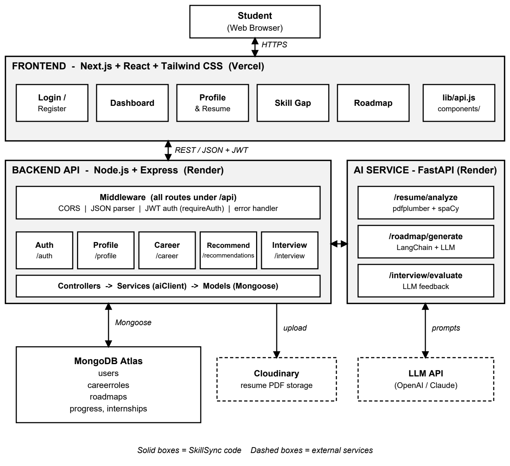
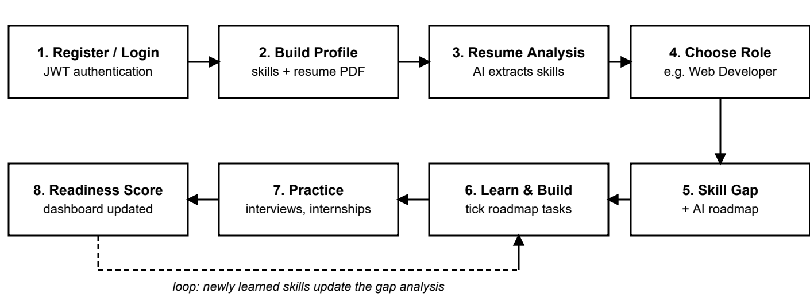
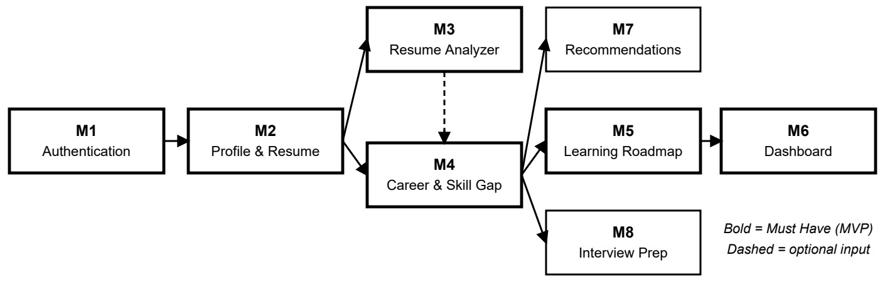

# SkillSync

**AI-Powered Student Skill Development and Career Guidance Platform**

SkillSync helps students find the gap between their current skills and the skills needed for a
chosen career role, then gives them a personalized learning roadmap, project ideas, internship
suggestions and interview practice.

> UNAI TECH Virtual Internship Program 2026 - Domain: Full-Stack Web Development with AI Integration

## Current Status

| Module | Status |
|--------|--------|
| **M1 – Authentication** | ✅ Register, login, logout, JWT-protected pages, brute-force protection ([docs](docs/modules/M1-authentication.md)) |
| **M2 – Profile & Resume** | ✅ Education details, skills, PDF resume upload / download / delete ([docs](docs/modules/M2-profile-resume.md)) |
| **M3 – Resume Analyzer (AI)** | ✅ First version: detects ~90 skills from resume text and normalizes typed skills ("Nextjs" → "Next.js"), connected to M2 |
| M4 – Career & Skill Gap | ⏳ Next (week 2) – placeholder page and planned API routes only |
| M5 – Learning Roadmap (AI) | ⏳ Planned – placeholder page only |
| M6 – Progress Dashboard | 🟡 Partly done – dashboard shows profile, skills and checklist; readiness score needs M4 |
| M7 – Recommendations, M8 – Interview Prep | ⏳ Planned (Should Have) |

**Tests:** 33 backend API tests + 15 AI service tests, all passing.

### Known limitations (honest status)

- Resumes are stored on the server's disk; deployment will need cloud storage (e.g. Cloudinary).
- The login token is kept in `localStorage`; an HTTP-only cookie would be more secure in production.
- The login rate limiter is in memory, so it resets when the server restarts.
- Skill detection uses keyword rules, not an LLM yet; scanned (image-only) resumes cannot be read.
- The app runs locally only; it has not been deployed yet.

## Architecture

SkillSync uses a simple **three-tier architecture** with a separate AI service:



- **Frontend** (Next.js) is the only part the student sees. It talks only to the backend API.
- **Backend** (Express) handles authentication, business logic and the database. It calls the AI
  service when AI work is needed.
- **AI Service** (FastAPI) handles resume analysis and LLM tasks. Keeping it separate lets it use
  Python's AI libraries and change without touching the main API.
- **MongoDB Atlas** stores users, career roles and roadmaps. **Cloudinary** stores resume files.

### User Workflow



| Input | Process | Output |
|-------|---------|--------|
| Account details (name, email, password) | Validate, hash password, issue JWT | Logged-in student |
| Resume PDF and manually entered skills | Extract text, detect skills (pdfplumber + spaCy) | List of current skills |
| Target career role | Compare current skills with the role's required skills | Skill gap: done / in progress / missing |
| Missing skills | LLM builds a week-by-week plan | Personalized learning roadmap |
| Completed tasks, interview answers | Update progress, evaluate answers with LLM | Readiness score, feedback, recommendations |

## Requirements

The full requirements specification is in **[docs/REQUIREMENTS.md](docs/REQUIREMENTS.md)**:
15 functional and 9 non-functional requirements, user requirements, 11 features
(input → processing → output), module dependencies, MoSCoW priorities and a 41-task development list.

| Priority | Features |
|----------|----------|
| **Must Have** (MVP) | Registration & Login, Student Profile & Resume Upload, Resume Analyzer, Career Role Selection & Skill Gap Analysis, Learning Roadmap, Progress Dashboard |
| **Should Have** | Project Recommendations, Internship Recommendations, AI Interview Preparation |
| **Could Have** | AI Career Assistant (chat), Google OAuth login, Email reminders and dark mode |

### Module Dependencies



An arrow from A to B means B needs A first. Critical path: **M1 → M2 → M4 → M5 → M6**.

## Modules

| # | Module | Responsibility | Where |
|---|--------|----------------|-------|
| 1 | **Authentication** | Register, login, password hashing, JWT tokens, protecting private routes | `backend/src/routes/auth.routes.js`, `middleware/auth.middleware.js`, `frontend/src/app/login`, `register` |
| 2 | **Profile & Resume** | Student details and skills, resume upload, sending the resume for analysis | `backend/src/routes/profile.routes.js`, `models/User.js`, `frontend/src/app/profile` |
| 3 | **Resume Analyzer (AI)** | Reads PDF text and detects skills | `ai-service/app/routers/resume.py`, `services/resume_parser.py` |
| 4 | **Career & Skill Gap** | Career roles and their required skills; compares them with the student's skills | `backend/src/routes/career.routes.js`, `models/CareerRole.js`, `frontend/src/app/skill-gap` |
| 5 | **Learning Roadmap (AI)** | Generates and stores a weekly plan; students tick off tasks | `career.routes.js`, `models/Roadmap.js`, `ai-service/app/routers/roadmap.py`, `frontend/src/app/roadmap` |
| 6 | **Recommendations** | Suggests portfolio projects and matching internships | `backend/src/routes/recommendation.routes.js` |
| 7 | **Interview Preparation (AI)** | Role-based questions and AI feedback on answers | `backend/src/routes/interview.routes.js`, `ai-service/app/routers/interview.py` |
| 8 | **Progress Dashboard** | Career readiness score, completed skills, roadmap progress | `frontend/src/app/dashboard` |

## Project Structure

```
skillsync/
├── frontend/                    Next.js + React + Tailwind CSS
│   ├── public/                  static assets (images, icons)
│   └── src/
│       ├── app/                 pages (App Router: one folder = one route)
│       │   ├── page.js          landing page
│       │   ├── layout.js        shared layout with navbar
│       │   ├── login/  register/  dashboard/  profile/  skill-gap/  roadmap/
│       ├── components/
│       │   ├── layout/          Navbar and page layout parts
│       │   └── ui/              reusable UI elements (Button, ...)
│       └── lib/
│           └── api.js           helper for calling the backend API
│
├── backend/                     Node.js + Express REST API
│   ├── src/
│   │   ├── server.js            app entry point
│   │   ├── config/              database connection
│   │   ├── routes/              one file per module, combined in index.js
│   │   ├── controllers/         request handling logic
│   │   ├── middleware/          JWT auth, error handling
│   │   ├── models/              Mongoose schemas (User, CareerRole, Roadmap)
│   │   ├── services/            calls to external services (AI service)
│   │   └── utils/               small shared helpers
│   └── tests/                   API tests
│
├── ai-service/                  Python + FastAPI
│   ├── app/
│   │   ├── main.py              app entry point
│   │   ├── routers/             endpoints: resume, roadmap, interview
│   │   ├── services/            resume parser, LLM client
│   │   └── schemas/             request/response models (Pydantic)
│   ├── tests/                   pytest tests
│   └── requirements.txt
│
├── docs/                        diagrams and planning documents
├── .gitignore
└── README.md
```

## API Endpoints (planned)

Endpoints marked ✅ work now; the others return `501 Not Implemented` until their module is built.

| Method | Endpoint | Module | Auth |
|--------|----------|--------|------|
| GET | `/api/health` ✅ | System | – |
| POST | `/api/auth/register` ✅ | Authentication | – |
| POST | `/api/auth/login` ✅ | Authentication | – |
| GET | `/api/auth/me` ✅ | Authentication | JWT |
| GET / PUT | `/api/profile` ✅ | Profile | JWT |
| POST / GET / DELETE | `/api/profile/resume` ✅ | Profile & Resume | JWT |
| GET | `/api/career/roles` | Career | – |
| GET | `/api/career/skill-gap` | Skill Gap | JWT |
| GET / POST | `/api/career/roadmap` | Roadmap | JWT |
| PATCH | `/api/career/roadmap/tasks/:taskId` | Roadmap | JWT |
| GET | `/api/recommendations/projects` | Recommendations | JWT |
| GET | `/api/recommendations/internships` | Recommendations | JWT |
| GET | `/api/interview/questions` | Interview | JWT |
| POST | `/api/interview/answers` | Interview | JWT |

AI service (internal, called by the backend): `GET /health` ✅, `POST /resume/analyze` ✅,
`POST /skills/normalize` ✅, `POST /roadmap/generate`, `POST /interview/evaluate`.

## Development Sequence

Modules are built in order of dependency, with the core features first:

1. **Authentication**: every other module needs a logged-in user
2. **Profile & Resume upload**: the source of the student's skills
3. **Resume Analyzer**: automatic skill detection
4. **Career & Skill Gap**: seed career roles, then compare skills
5. **Learning Roadmap**: AI-generated plan for the missing skills
6. **Progress Dashboard**: readiness score from completed tasks (**MVP complete**)
7. **Recommendations**: projects and internships
8. **Interview Preparation**: AI mock interviews
9. **Testing and deployment**: Vercel and Render

## Tech Stack

| Layer      | Technology                                  |
|------------|---------------------------------------------|
| Frontend   | Next.js, React.js, Tailwind CSS             |
| Backend    | Node.js, Express.js, Mongoose, JWT, bcrypt  |
| Database   | MongoDB Atlas                               |
| AI Service | Python, FastAPI, pdfplumber, spaCy, LangChain, LLM API |
| Storage    | Cloudinary (resume files)                   |
| Deployment | Vercel (frontend), Render (backend + AI)    |

## Getting Started

**Prerequisites:** Node.js 20+, Python 3.10+, Git, MongoDB (local install or a MongoDB Atlas connection string)

### 1. Frontend (http://localhost:3000)
```bash
cd frontend
npm install
cp .env.example .env.local
npm run dev
```

### 2. Backend (http://localhost:5000)
```bash
cd backend
npm install
cp .env.example .env     # then fill in your own values
npm run dev
```
Check: http://localhost:5000/api/health

### 3. AI Service (http://localhost:8000)
```bash
cd ai-service
python -m venv venv
venv\Scripts\activate        # Windows  (macOS/Linux: source venv/bin/activate)
pip install -r requirements.txt
cp .env.example .env
uvicorn app.main:app --reload --port 8000
```
Check: http://localhost:8000/health. Interactive API docs: http://localhost:8000/docs

### Run tests
```bash
cd backend && npm test        # API tests: authentication (15) + profile & resume (18)
cd ai-service && pytest       # skill detection and normalization tests (15)
```

### Maintenance scripts
```bash
cd backend && node scripts/normalize-skills.js   # one-time: convert saved skills to standard names
```

## Environment Variables

Real `.env` files are **not committed**. Copy each `.env.example` to `.env` (or `.env.local` for
the frontend) and add your own values.

## Project Progress

- [x] Phase 1 Day 1: Development environment setup
- [x] Phase 1 Day 2: Git & GitHub version control
- [x] Phase 1 Day 3: Project structure, modules and architecture
- [x] Phase 1 Day 4: Requirements analysis and module planning
- [x] Phase 1 Day 5: **M1 Authentication** - register, login, logout, JWT-protected dashboard (12 passing tests)
- [x] Phase 1 Day 6: **M1 improvements** (brute-force protection, 72-byte password limit, auto-logout) and **M2 Profile & Resume** connected to the **AI Resume Analyzer**
- [x] Phase 1 Day 7: Project review – skill normalization fix, repository clean-up, status and next-week plan

### Next week (Phase 1, week 2)

| Day | Goal |
|-----|------|
| 1 | Research required skills for the 5 career roles; seed script for `CareerRole` |
| 2 | `GET /api/career/roles`, role selection page, save target role |
| 3 | Skill-gap logic (done / missing, match %) with unit tests |
| 4 | Skill Gap results page; connect the readiness score to the dashboard |
| 5 | LLM prompt + `/roadmap/generate` (JSON output, validation, error handling) |
| 6 | Roadmap page with weekly tasks and progress saving |
| 7 | Testing, bug fixes, README and weekly review |

- [ ] M4 Career roles & Skill Gap Analysis
- [ ] M5 Learning Roadmap (AI)
