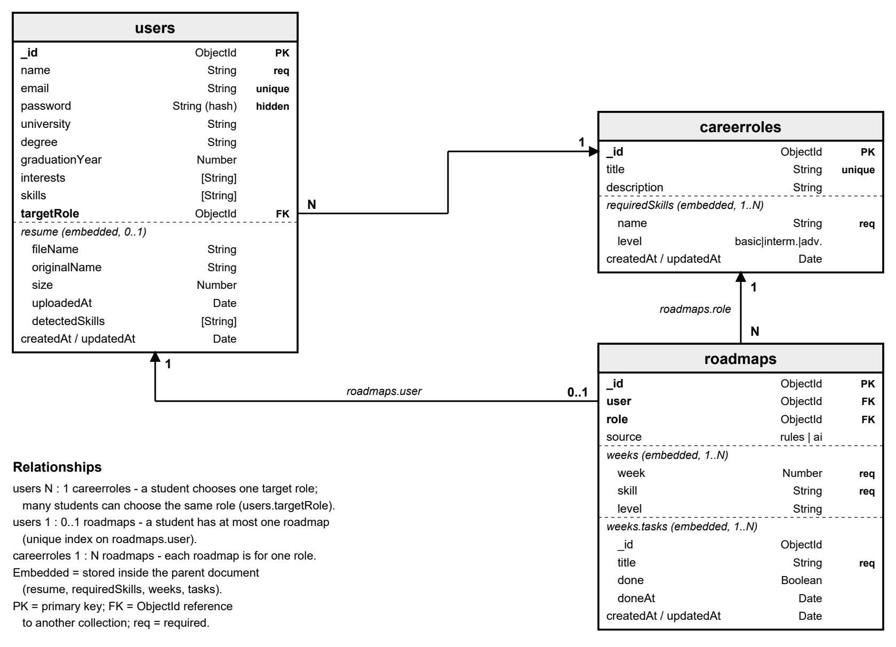

# SkillSync Database Design

**Database:** MongoDB 7 (document database) through **Mongoose** (schemas, validation, references)  
**Local:** `mongodb://127.0.0.1:27017/skillsync` · **Deployment:** MongoDB Atlas  
**Connection:** `backend/src/config/db.js`, reads `MONGO_URI` from `backend/.env` (never committed)



## Why MongoDB

- The project already uses JavaScript end-to-end (Next.js + Express), and documents map directly to JS objects.
- Student data has natural **nested parts** that are always read together with their parent: a user's
  resume details, a role's required skills, a roadmap's weeks and tasks. These are **embedded** instead of
  being split into extra tables, so one query returns everything a page needs.
- Data that is shared or changes independently (career roles, roadmaps) lives in **separate collections**
  linked by `ObjectId` references (similar to foreign keys in SQL).
- MongoDB Atlas has a free tier for deployment.

## Data the application stores

| Entity | What it holds | Created by |
|---|---|---|
| **User** (student) | Account, hashed password, education, interests, skills, resume details, chosen career role | Registration (M1), Profile (M2) |
| **Resume** (embedded in User) | Original file name, size, upload date, skills detected by the AI service. The PDF itself is stored on disk | Resume upload (M2/M3) |
| **CareerRole** | Title, description, required skills with level | Seed script `npm run seed:roles` (M4) |
| **Roadmap** | Week-by-week plan for the student's missing skills, with tasks that can be ticked off | Roadmap page (M5) |

Not stored on purpose: plain-text passwords, JWT tokens (they are stateless), and the resume PDF itself
(only a random file name that is never sent to the browser).

## Collections and fields

### `users`

| Field | Type | Rules |
|---|---|---|
| `_id` | ObjectId | Primary key (automatic) |
| `name` | String | required, trimmed, max 60 |
| `email` | String | required, **unique index**, lower-case |
| `password` | String | required, **bcrypt hash**, `select: false` (never returned by queries) |
| `university`, `degree` | String | optional |
| `graduationYear` | Number | optional, 1980 to current year + 8 (validated in the API) |
| `interests`, `skills` | [String] | trimmed, duplicates removed; skills normalized ("Nextjs" → "Next.js") |
| `resume` | embedded object or `null` | `fileName`, `originalName`, `size`, `uploadedAt`, `detectedSkills[]` |
| `targetRole` | ObjectId → `careerroles` | the student's chosen career goal |
| `createdAt`, `updatedAt` | Date | automatic (`timestamps`) |

### `careerroles`

| Field | Type | Rules |
|---|---|---|
| `_id` | ObjectId | Primary key |
| `title` | String | required, **unique index** |
| `description` | String | |
| `requiredSkills` | embedded array | `name` (required), `level`: `basic` \| `intermediate` \| `advanced` |
| `createdAt`, `updatedAt` | Date | automatic |

### `roadmaps`

| Field | Type | Rules |
|---|---|---|
| `_id` | ObjectId | Primary key |
| `user` | ObjectId → `users` | required, **unique index** (one roadmap per student) |
| `role` | ObjectId → `careerroles` | required |
| `source` | String | `rules` (task templates, now) or `ai` (LLM, later) |
| `weeks` | embedded array | `week` (≥ 1), `skill`, `level`, `tasks[]` |
| `weeks.tasks` | embedded array | `_id` (so one task can be updated), `title`, `done`, `doneAt` |
| `createdAt`, `updatedAt` | Date | automatic |

## Relationships

| Relationship | Type | How it is stored |
|---|---|---|
| User → CareerRole | many-to-one | `users.targetRole` holds the role's `_id`; many students can choose the same role |
| User → Roadmap | one-to-zero-or-one | `roadmaps.user` holds the user's `_id`; the unique index stops a second roadmap |
| CareerRole → Roadmap | one-to-many | `roadmaps.role` holds the role's `_id` |
| User → Resume | one-to-zero-or-one | embedded inside the user document |
| Roadmap → Weeks → Tasks | one-to-many | embedded arrays |

References are followed with Mongoose `populate()` (e.g. the roadmap response includes the role title).
When an account is deleted, its roadmap and resume file are deleted first, so no orphan data remains.

## Indexes

| Collection | Index | Purpose |
|---|---|---|
| users | `email` (unique) | fast login lookup; no duplicate accounts, even with two sign-ups at the same time |
| careerroles | `title` (unique) | the seed script can run again without creating duplicates |
| roadmaps | `user` (unique) | fast "get my roadmap"; one roadmap per student |

A duplicate-key error (code 11000) is turned into a friendly `409` response by the error middleware.

## CRUD operations implemented

| Operation | Endpoint (all need a JWT except where noted) | Mongoose call | Collection |
|---|---|---|---|
| **Create** | `POST /api/auth/register` (public) | `User.create()` (password hashed in a `pre("save")` hook) | users |
| **Create** | `POST /api/career/roadmap` | `Roadmap.create()` with one week per missing skill | roadmaps |
| **Create / Update** | `npm run seed:roles` | `CareerRole.findOneAndUpdate(..., { upsert: true })` | careerroles |
| **Read** | `GET /api/auth/me`, `GET /api/profile` | `User.findById()` | users |
| **Read** | `GET /api/career/roles` (public) | `CareerRole.find().sort()` | careerroles |
| **Read** | `GET /api/career/skill-gap` | `User.findById().populate("targetRole")` + `Roadmap.findOne()` | users, careerroles, roadmaps |
| **Read** | `GET /api/career/roadmap` | `Roadmap.findOne({ user }).populate("role")` | roadmaps |
| **Update** | `PUT /api/profile` | load → change fields → `user.save()` (validation runs) | users |
| **Update** | `PUT /api/career/target-role` | `user.targetRole = role._id` → `save()` | users |
| **Update** | `PATCH /api/career/roadmap/tasks/:taskId` | find task inside the student's own roadmap → `done`, `doneAt` → `save()` | roadmaps |
| **Delete** | `DELETE /api/profile/resume` | `user.resume = null` + file removed from disk | users |
| **Delete** | `DELETE /api/career/roadmap` | `Roadmap.deleteOne({ user })` | roadmaps |
| **Delete** | `DELETE /api/profile` (password required) | `Roadmap.deleteMany()` → resume file removed → `user.deleteOne()` | users, roadmaps |

Every query that changes data includes the logged-in student's id (`req.user.id` from the JWT), so a
student can only read or change their own data. This is covered by automated tests.

## Scripts

```bash
cd backend
npm run seed:roles                 # insert/update the 5 career roles
npm run db:overview                # collections, document counts, indexes, one sample each (secrets hidden)
npm run db:crud-demo               # runs Create, Read, Update, Delete on a temporary student, then removes it
node scripts/normalize-skills.js   # one-time: standard skill names (Day 7)
node scripts/remove-old-fields.js  # one-time: removes unused fields from the first User schema (Day 9)
```

## Security

- `MONGO_URI` and `JWT_SECRET` are only in `backend/.env`, which is listed in `.gitignore`;
  `backend/.env.example` contains placeholders only.
- Passwords are stored as bcrypt hashes and excluded from every query result and JSON response.
- The stored resume file name is removed before a user is sent to the browser.
- Tests use separate databases (`skillsync_test_*`) that are dropped after each run, so development
  data is never touched.

## Testing

`backend/tests/roadmap.test.js` (13 tests) covers Create, Read, Update and Delete on roadmaps, validation,
privacy between students, the unique index and the link to the skill gap. `profile.test.js` covers account
deletion, including removal of the roadmap and resume file. Total: **57 backend tests, all passing.**
