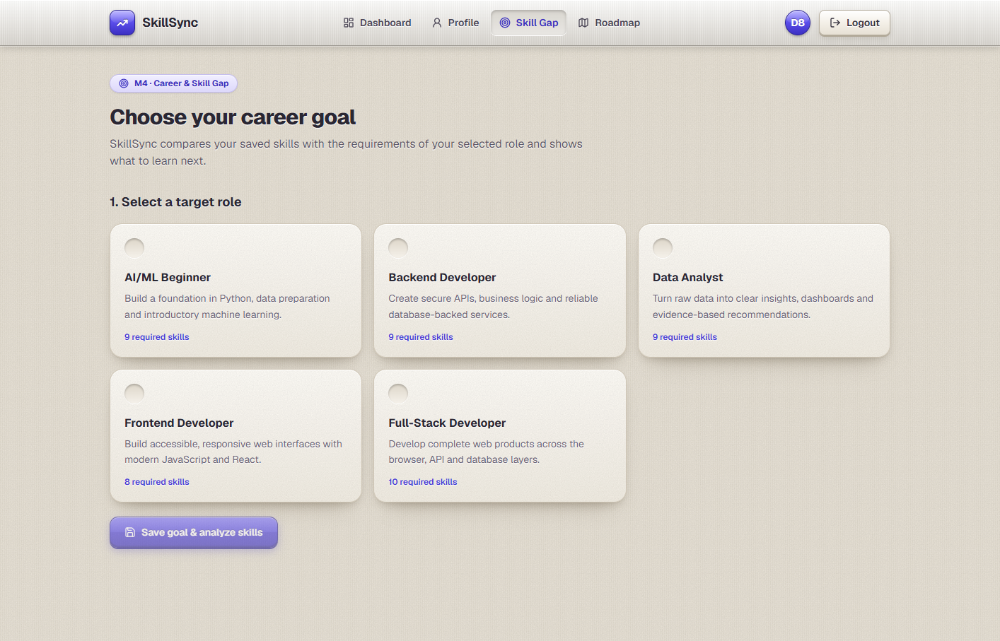
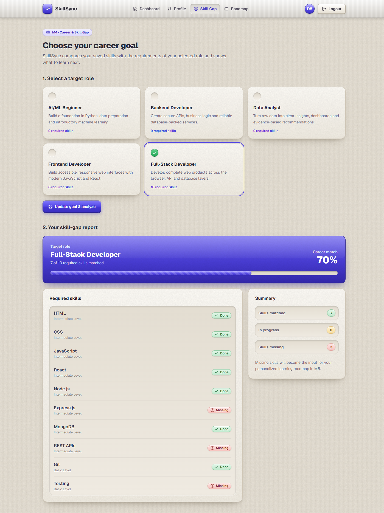

# Phase 1 Day 8 – Career Role & Skill Gap Analysis

**Project:** SkillSync – AI-Powered Student Skill Development and Career Guidance Platform  
**Repository:** https://github.com/GMD369/skillsync  
**Feature:** M4 – Career Role Selection and Skill Gap Analysis

## Review of Week 1

The authentication, profile, resume upload and resume-analysis modules were reviewed first. Their
existing 48 automated tests continued to pass. M4 was selected because it is the next Must Have
feature in the approved dependency order and connects directly to the normalized skills already saved
by M2/M3. The roadmap and real readiness dashboard depend on its output.

## Functionality developed

1. A repeatable seed command adds the five approved career roles and their required skill levels.
2. Any visitor can load the available roles; selecting a role requires a valid JWT.
3. The selected role is validated and saved in the existing `User.targetRole` field.
4. The backend compares normalized profile skills case-insensitively with the role requirements.
5. The result includes matched/missing skills, required levels and a rounded match percentage.
6. The Skill Gap page displays selectable role cards, loading/error states, a progress report and
   individual skill statuses.
7. The existing Dashboard now loads the saved match percentage as its career-readiness value.

The `inProgress` count remains zero until M5 supplies real roadmap progress. The application avoids
guessing proficiency from a skill name alone.

## Main source files

- `backend/src/controllers/career.controller.js` – role list, selection and comparison logic
- `backend/src/routes/career.routes.js` – three working M4 API routes
- `backend/scripts/seed-career-roles.js` – five approved role definitions
- `backend/tests/career.test.js` – nine M4 API tests
- `frontend/src/app/skill-gap/page.js` – complete interactive page
- `frontend/src/app/dashboard/page.js` – skill-match integration
- `docs/modules/M4-career-skill-gap.md` – API and module documentation

## Input validation and errors

- Missing or malformed role IDs return `400` with a field error.
- A valid but unknown role returns `404`.
- Selection and reports without a JWT return `401`.
- Requesting a report before selecting a target role returns `400` with an actionable message.
- A role with no requirements safely returns `0%`, avoiding division by zero.
- The frontend disables submission until a role is selected and shows API failures in an alert.

## Testing results

| Check | Result |
|---|---|
| Existing authentication tests | 15 passed |
| Existing profile/resume tests | 18 passed |
| New career/skill-gap tests | 9 passed |
| Total backend tests | **42 passed, 0 failed** |
| AI service tests | **15 passed, 0 failed** |
| Frontend ESLint | Passed |
| Next.js production build | Passed; all eight routes generated |
| Manual integrated flow | Five roles loaded; selection persisted; 70% demo match produced |

## Screenshots

### Five career roles loaded from the backend



### Full-Stack Developer skill-gap report



## Challenges encountered

- The current profile stores skill names but not proficiency levels. The report therefore labels
  confirmed exact matches as done and the rest as missing; roadmap progress will add in-progress data.
- Skill names must compare consistently across resume detection, manual entry and role requirements.
  Reusing the Day 7 normalization output and case-insensitive comparison prevents spelling/case errors.
- The feature had to update existing authenticated user state immediately. Returning the updated user
  after role selection keeps the navbar, checklist, Skill Gap page and Dashboard synchronized.
- The seed operation must be safe to repeat. It upserts by the role's unique title instead of inserting
  duplicates.

## Run locally

```bash
cd backend
npm run seed:roles
npm run dev

cd ../frontend
npm run dev
```
