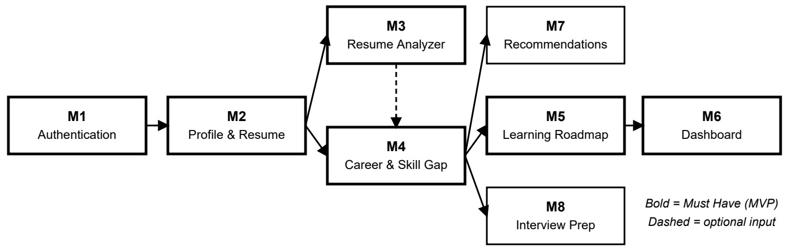

# SkillSync - Requirements Specification

**Project:** SkillSync - AI-Powered Student Skill Development and Career Guidance Platform  
**Phase 1 - Day 4:** Requirements Analysis & Module Planning

## 1. Scope

**In scope (MVP for the internship):**

- Student registration and login with JWT authentication
- Student profile with manual skills and PDF resume upload
- AI resume analysis that detects skills from the resume
- Skill gap analysis for 5 predefined career roles (Frontend Developer, Backend Developer, Full-Stack Developer, Data Analyst, AI/ML Beginner)
- AI-generated week-by-week learning roadmap with free resources
- Progress dashboard with a career readiness score
- Project and internship recommendations and AI interview practice (if time allows)

**Out of scope:**

- Mobile app (the web app will be responsive instead)
- Live scraping of job portals (internships come from a curated list in MongoDB)
- Voice or video interviews (only typed answers)
- Payments, recruiter accounts and a full admin panel

## 2. Functional Requirements

| ID | Requirement | Module | Priority |
|----|-------------|--------|----------|
| FR-01 | The system shall allow a student to register with name, email and password. | Authentication | Must |
| FR-02 | The system shall allow a registered student to log in and log out; a JWT token is issued on login. | Authentication | Must |
| FR-03 | The system shall block private pages and APIs for users who are not logged in. | Authentication | Must |
| FR-04 | The student shall be able to view and edit their profile (education, interests). | Profile & Resume | Must |
| FR-05 | The student shall be able to add and remove skills manually. | Profile & Resume | Must |
| FR-06 | The student shall be able to upload a resume in PDF format (max 2 MB). | Profile & Resume | Must |
| FR-07 | The system shall extract skills from the uploaded resume and let the student confirm or edit them. | Resume Analyzer | Must |
| FR-08 | The system shall list the available career roles and let the student select a target role. | Career & Skill Gap | Must |
| FR-09 | The system shall compare the student's skills with the role's required skills and mark each as done, in progress or missing, with a match percentage. | Career & Skill Gap | Must |
| FR-10 | The system shall generate a week-by-week learning roadmap with free resources for the missing skills. | Learning Roadmap | Must |
| FR-11 | The student shall be able to mark roadmap tasks as complete, and progress shall be saved. | Learning Roadmap | Must |
| FR-12 | The system shall show a dashboard with career readiness %, completed skills and current roadmap week. | Progress Dashboard | Must |
| FR-13 | The system shall suggest portfolio projects that use the student's missing skills. | Recommendations | Should |
| FR-14 | The system shall recommend internships ranked by how well their required skills match the student. | Recommendations | Should |
| FR-15 | The system shall generate role-based interview questions and give a score and improvement tips for typed answers. | Interview Preparation | Should |

## 3. Non-Functional Requirements

| ID | Category | Requirement |
|----|----------|-------------|
| NFR-01 | Performance | Pages load in under 3 seconds; normal API requests respond in under 500 ms; AI requests (roadmap, interview feedback) complete in under 15 seconds with a loading indicator. |
| NFR-02 | Security | Passwords hashed with bcrypt; JWT tokens expire after 7 days; API keys and secrets kept in .env files (never on GitHub); a student can only access their own data; all input validated. |
| NFR-03 | File Safety | Only PDF files up to 2 MB are accepted for resumes; files are stored privately on Cloudinary. |
| NFR-04 | Usability | Simple navigation: every main feature reachable within 3 clicks from the dashboard; clear error messages; beginner-friendly language. |
| NFR-05 | Responsiveness | Works on mobile, tablet and desktop screens, and in current Chrome, Edge and Firefox. |
| NFR-06 | Reliability | If the AI service or LLM fails, the app shows a friendly message instead of crashing; generated roadmaps are saved so they are not regenerated on every visit. |
| NFR-07 | Maintainability | Modular code (one file per module), consistent style (ESLint), documented in README, and tests for core logic such as skill-gap calculation and resume parsing. |
| NFR-08 | Cost | Runs on free tiers (Vercel, Render, MongoDB Atlas, Cloudinary); LLM requests limited per user per day to control cost. |
| NFR-09 | Privacy | Resume data is used only for analysis; a student can delete their resume and account. |

## 4. User Requirements

| User | Expectations |
|------|--------------|
| University / college student | Know exactly which skills are needed for a chosen career Get a clear, step-by-step learning plan instead of random tutorials See progress and stay motivated |
| Fresh graduate | Quickly check job readiness for a role Find internships that match current skills Practise interview questions with feedback |
| Beginner in tech | Simple, easy-to-use interface Beginner-friendly, free learning resources Project ideas to build a first portfolio |
| All users | Free to use Personal data and resume kept private Fast and works on mobile |

## 5. Feature Breakdown

| # | Feature | Purpose | Input | Processing | Output | Priority |
|---|---------|---------|-------|------------|--------|----------|
| F1 | **Registration & Login** | Give each student a secure personal account | Name, email, password | Validate input, hash password (bcrypt), check credentials, create JWT token | Account created / student logged in | Must |
| F2 | **Student Profile** | Store the student's background and current skills | Education, interests, list of skills | Validate and save to the User record in MongoDB | Updated profile | Must |
| F3 | **Resume Upload & Analyzer** | Detect skills automatically from the resume | Resume PDF (max 2 MB) | Upload to Cloudinary; AI service extracts text (pdfplumber) and detects skills (keywords + spaCy) | List of detected skills for the student to confirm | Must |
| F4 | **Career Role Selection** | Let the student choose a career goal | Selected role (e.g. Frontend Developer) | Load the role and its required skills from the database | Target role saved to profile | Must |
| F5 | **Skill Gap Analysis** | Show the difference between current and required skills | Student skills + target role | Compare each required skill with the student's skills and calculate match % | Skills marked done / in progress / missing, match % | Must |
| F6 | **Learning Roadmap** | Turn missing skills into a clear weekly plan | Missing skills, available weeks | LLM generates a JSON plan with tasks and free resources; validated and saved | Week-by-week roadmap with tick-off tasks | Must |
| F7 | **Progress Dashboard** | Show overall career readiness and motivate the student | Completed tasks and skills | Readiness % = completed required skills / total required skills | Readiness score, stat cards, progress chart | Must |
| F8 | **Project Recommendations** | Help the student build a portfolio | Missing skills, target role | Match skills against a project ideas list | 3-5 suggested projects with the skills they practise | Should |
| F9 | **Internship Recommendations** | Connect the student to suitable opportunities | Student skills | Rank internships by skill overlap with the student | Ranked list of matching internships | Should |
| F10 | **AI Interview Preparation** | Help the student practise for interviews | Target role, typed answers | LLM generates questions and evaluates answers | Score (out of 10) and improvement tips | Should |
| F11 | **AI Career Assistant** | Answer career questions in a chat | Student's question | LLM answers using the student's profile as context | Personalized answer | Could |

## 6. Module Breakdown and Dependencies

| Module | Features | Responsibility | Depends On |
|--------|----------|----------------|------------|
| M1. Authentication | Registration & Login | Accounts, password hashing, JWT tokens, protecting private routes | None |
| M2. Profile & Resume | Student Profile, Resume upload | Student details and skills, resume file storage | M1 |
| M3. Resume Analyzer (AI) | Resume Analyzer | PDF text extraction and skill detection in the AI service | M2 |
| M4. Career & Skill Gap | Career Role Selection, Skill Gap Analysis | Career roles data, comparing skills, match % | M2 (M3 improves accuracy) |
| M5. Learning Roadmap (AI) | Learning Roadmap | LLM roadmap generation, storing plans, task completion | M4 |
| M6. Progress Dashboard | Progress Dashboard | Readiness score and progress overview | M4, M5 |
| M7. Recommendations | Project & Internship Recommendations | Project ideas, internship data and skill-based matching | M4 |
| M8. Interview Preparation (AI) | AI Interview Preparation | Interview questions, answer evaluation, attempt history | M1, M4 |

An arrow from A to B means B needs A to be built first.

## 7. Feature Prioritization (MoSCoW)

| Priority | Feature | Reason |
|----------|---------|--------|
| Must Have | Registration & Login | Every other feature needs a logged-in student |
| Must Have | Student Profile & Resume Upload | Source of the student's current skills |
| Must Have | Resume Analyzer | Core AI feature; detects skills automatically |
| Must Have | Career Role Selection & Skill Gap Analysis | The main problem SkillSync solves |
| Must Have | Learning Roadmap | Turns the skill gap into clear next steps |
| Must Have | Progress Dashboard | Shows readiness and keeps students motivated |
| Should Have | Project Recommendations | Helps build a portfolio; simple once the gap is known |
| Should Have | Internship Recommendations | Valuable, but needs internship data to be collected |
| Should Have | AI Interview Preparation | Useful practice; needs extra prompt work and testing |
| Could Have | AI Career Assistant (chat) | Nice extra; overlaps with other features |
| Could Have | Google OAuth login | Convenience only; email login is enough for the MVP |
| Could Have | Email reminders and dark mode | Polish features if time remains in the final week |

## 8. Development Task List

41 tasks across 9 work packages. Each task can be completed and tested independently.

### M1. Authentication (Week 2)

| ID | Task | Area | Status |
|----|------|------|--------|
| T1.1 | Design the login and register page layouts | Frontend | To Do |
| T1.2 | Build the login and register forms with input validation (email format, password length) | Frontend | To Do |
| T1.3 | Implement POST /api/auth/register: validate input, check duplicate email, hash password | Backend | To Do |
| T1.4 | Implement POST /api/auth/login: verify password and return a JWT token | Backend | To Do |
| T1.5 | Store the token, add logout and redirect logged-out users away from private pages | Frontend | To Do |
| T1.6 | Test successful and failed logins: wrong password, duplicate email, missing fields, expired token | Testing | To Do |

### M2. Profile & Resume (Week 3)

| ID | Task | Area | Status |
|----|------|------|--------|
| T2.1 | Build the profile page with education and interests form | Frontend | To Do |
| T2.2 | Implement GET and PUT /api/profile | Backend | To Do |
| T2.3 | Create an add/remove skills component | Frontend | To Do |
| T2.4 | Implement resume upload with Multer + Cloudinary (PDF only, max 2 MB) | Backend | To Do |
| T2.5 | Test profile updates and invalid uploads (wrong type, too large) | Testing | To Do |

### M3. Resume Analyzer (AI) (Week 4)

| ID | Task | Area | Status |
|----|------|------|--------|
| T3.1 | Expand the skill keyword list to about 100 common tech skills | AI Service | To Do |
| T3.2 | Improve skill detection with spaCy phrase matching | AI Service | To Do |
| T3.3 | Call /resume/analyze from the backend (aiClient) after upload | Backend | To Do |
| T3.4 | Show detected skills so the student can confirm or edit them | Frontend | To Do |
| T3.5 | Test with at least 3 sample resumes of different layouts | Testing | To Do |

### M4. Career & Skill Gap (Week 4)

| ID | Task | Area | Status |
|----|------|------|--------|
| T4.1 | Research required skills for the 5 roles and write a database seed script | Backend | To Do |
| T4.2 | Implement GET /api/career/roles and the role selection page | Full-Stack | To Do |
| T4.3 | Write the gap comparison logic and match % calculation | Backend | To Do |
| T4.4 | Build the skill gap results page (done / in progress / missing) | Frontend | To Do |
| T4.5 | Write unit tests for the gap comparison logic | Testing | To Do |

### M5. Learning Roadmap (AI) (Week 5)

| ID | Task | Area | Status |
|----|------|------|--------|
| T5.1 | Design the LLM prompt that returns the roadmap as JSON | AI Service | To Do |
| T5.2 | Implement /roadmap/generate with response validation | AI Service | To Do |
| T5.3 | Implement roadmap save, get and task-complete endpoints | Backend | To Do |
| T5.4 | Build the roadmap page with week cards and checkboxes | Frontend | To Do |
| T5.5 | Handle AI errors and timeouts; limit regenerations per day | Backend | To Do |

### M6. Progress Dashboard (Week 5)

| ID | Task | Area | Status |
|----|------|------|--------|
| T6.1 | Implement the readiness score calculation | Backend | To Do |
| T6.2 | Create a dashboard summary API endpoint | Backend | To Do |
| T6.3 | Build stat cards and a progress chart (Chart.js) | Frontend | To Do |
| T6.4 | Test the dashboard with sample student data | Testing | To Do |

### M7. Recommendations (Week 6)

| ID | Task | Area | Status |
|----|------|------|--------|
| T7.1 | Create a project ideas list mapped to skills | Backend | To Do |
| T7.2 | Collect 30+ internships and add them with a seed script | Backend | To Do |
| T7.3 | Implement skill-overlap matching and ranking | Backend | To Do |
| T7.4 | Build the project and internship recommendation pages | Frontend | To Do |

### M8. Interview Preparation (AI) (Week 7)

| ID | Task | Area | Status |
|----|------|------|--------|
| T8.1 | Generate role-based interview questions with the LLM | AI Service | To Do |
| T8.2 | Implement answer evaluation with a score and tips | AI Service | To Do |
| T8.3 | Build the interview practice page | Frontend | To Do |
| T8.4 | Save interview attempts so students can see improvement | Backend | To Do |

### Testing & Deployment (Week 8)

| ID | Task | Area | Status |
|----|------|------|--------|
| T9.1 | Test the full student journey end to end and fix bugs | Testing | To Do |
| T9.2 | Deploy the frontend to Vercel and the backend + AI service to Render | DevOps | To Do |
| T9.3 | Update README, record a demo video and prepare the final presentation | Docs | To Do |
